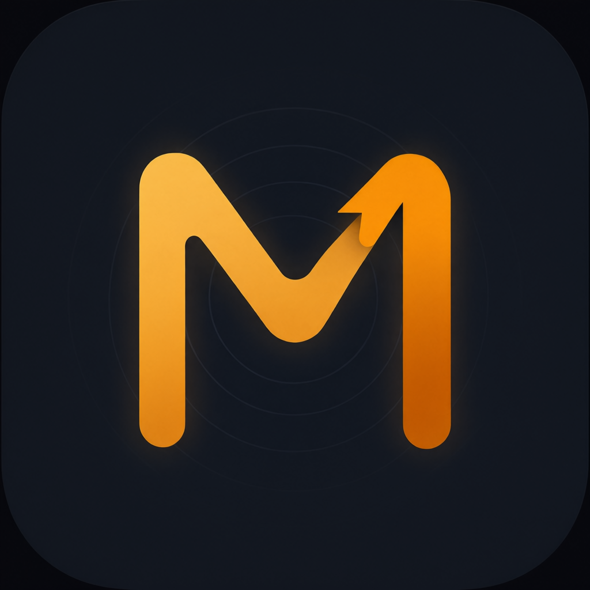

# Makuris

**English** | [简体中文](README.zh-CN.md)



**Control the computer at home from your phone.** Open source, self-hosted, cross-platform.

Makuris is a remote desktop solution: the host runs on the computer you want to control, and the viewer is an iOS app.
Video and input travel between the two ends over WebRTC, directly or through a relay; the signaling server only introduces them and never touches the data.

[](LICENSE)


---

## Features

- **Zero configuration on the local network**: the host advertises `_makuris._tcp` over Bonjour, so opening the app on the same Wi-Fi lists the computer automatically,
  with no address to type and no central server involved.
- **Works across networks**: when the two ends are not on the same network, they negotiate through the signaling server and build a WebRTC connection with help from coturn (STUN/TURN); it gets video through even on 4G.
- **End-to-end encrypted media**: WebRTC's DTLS-SRTP; the signaling server sees neither the screen nor the input.
- **Hardware encoding**: macOS encodes with VideoToolbox and captures at 2× the physical resolution, so text stays sharp.
- **Full input control**: mouse move / left and right buttons / scroll wheel / drag, plus keyboard text input;
  on Windows it also handles multi-monitor virtual desktop coordinates and modifier-key state.
- **Multiple channels**: the auto-scanned "Local Network" and every saved address are each a channel, and each channel carries its own computers;
  after a network change the app reconnects by itself, with no need to restart.

## Platform support

| Component | Platform | Status | Notes |
| --- | --- | --- | --- |
| Host | macOS | ✅ Available | CGWindowList capture, CGEvent injection, VideoToolbox hardware encoding, system Bonjour |
| Host | Windows | ✅ Available | GDI BitBlt capture (declared DPI aware), SendInput injection, openh264 encoding, mdns-sd advertisement |
| Host | Linux | ⬜ Not implemented | Planned |
| Viewer | iOS | ✅ Available | Swift + WebRTC, Bonjour auto-discovery plus manually saved addresses |
| Viewer | Android | ⬜ Not implemented | Planned |
| Signaling server | Cross-platform | ✅ Available | Rust axum + WebSocket, deployable with Docker |
| TURN relay | Linux | ✅ Available | coturn, `use-auth-secret` time-limited credentials |

## How it works

```
                    ┌──────────────────────────────────────────┐
                    │             Signaling server             │
                    │      Rust axum, wss://<host>:8443        │
                    │   device registry / relay / TURN creds   │
                    └──────────────┬───────────────────────────┘
                                   │ signaling: SDP / ICE / pairing
                 ┌─────────────────┴──────────┐
                 │                            │
      ┌──────────▼───────────┐      ┌───────────▼──────────┐
      │         Host         │◄────►│        Viewer        │
      │    macOS / Windows   │      │       iOS app        │
      │   capture, encode,   │WebRTC│  receive, render,    │
      │   stream out         │      │  send input back     │
      └──────────────────────┘      └──────────────────────┘
                 │
                 │ Same LAN: Bonjour advertisement + built-in
                 │ direct signaling on 8444 — no central server
                 └──────────────────────────────────────────┘
```

Two paths:

1. **Local network**: Bonjour discovery → built-in signaling directly on port 8444 → local WebRTC connection (traffic passes through no server).
2. **Across networks**: connect to the wss signaling server → ICE hole punching, falling back to the coturn relay when it fails.

## Repository layout

```
makuris/
├── proto/                 # Shared protocol: signaling messages, input events, pairing (Rust)
├── host/                  # Host (Rust)
│   ├── src/capture/       # Screen capture (macOS surface / Windows GDI)
│   ├── src/encode/        # Video encoding (VideoToolbox hardware / openh264)
│   ├── src/input/         # Input injection (CGEvent / SendInput)
│   ├── src/lan.rs         # Local-network direct signaling + Bonjour advertisement
│   ├── src/bonjour.rs     # System Bonjour FFI (macOS only)
│   ├── src/pairing.rs     # Pairing and trust tokens
│   ├── src/tls_pin.rs     # Certificate pinning for the signaling wss
│   └── src/turn.rs        # TURN relay client
├── signaling-server/      # Signaling server (Rust axum + WebSocket + TLS)
├── ios-client/            # iOS viewer (Swift + WebRTC)
├── deploy/                # Docker Compose (signaling + coturn) and systemd units
├── packaging/             # macOS .app packaging (includes the menu bar helper)
├── scripts/               # Deployment and diagnostic scripts (cloud / windows / e2e)
├── brand/                 # Logo master files
└── docs/                  # Documentation (includes the pre-open-source security audit)
```

## Getting started

### Prerequisites

- Rust stable toolchain (edition 2021)
- Xcode Command Line Tools for the macOS host
- Full Xcode 16+ and a physical device for the iOS viewer; see [ios-client/SETUP.md](ios-client/SETUP.md)

### 1. Start the host

```bash
cargo run -p makuris-host
```

Grant permissions on first run:

- **macOS**: Screen Recording + Accessibility (System Settings → Privacy & Security)
- **Windows**: to control windows that run with administrator privileges, the host itself must also run as administrator

### 2. Local network connection (zero configuration)

Put the phone and the computer on the same Wi-Fi and open the app; the "Local Network" channel on the home screen lists the computer automatically, and tapping it opens the screen.

### 3. Cross-network connection

Start the signaling server:

```bash
cargo run -p makuris-signaling
# listens on ws://0.0.0.0:8443/ws by default
```

Point the host at it (both ends must use the same access key):

```bash
MAKURIS_SIGNALING=wss://your-server:8443/ws \
MAKURIS_ACCESS_KEY=<same as the signaling side> \
cargo run -p makuris-host
```

Or bring up signaling and coturn together with Docker Compose:

```bash
cd deploy && docker compose up -d
# change coturn's TURN secret and configure TLS before going live
```

### 4. Build the iOS viewer

```bash
open ios-client/Makuris.xcodeproj
```

Key settings such as the Bonjour permission declaration are in [ios-client/SETUP.md](ios-client/SETUP.md).

### 5. Run the tests

```bash
cargo test -p makuris-proto
```

## Configuration

### Host

| Variable | Default | Description |
| --- | --- | --- |
| `MAKURIS_DEVICE_ID` | `host-mac-01` / `host-win-01` / `host-linux-01` | Device identifier, the routing key for signaling |
| `MAKURIS_SIGNALING` | empty | Signaling address (e.g. `wss://host:8443/ws`); when empty the host serves the local network only |
| `MAKURIS_ACCESS_KEY` | empty | Access key; must match the signaling server |
| `MAKURIS_PAIRING_CODE` | randomly generated | A fixed pairing code; by default one is generated and written to the state directory |
| `MAKURIS_LAN_PORT` | `8444` | Port for the built-in local-network signaling |
| `MAKURIS_UDP_PORT` | automatic | UDP port for the direct WebRTC connection |
| `MAKURIS_STUN` | built-in public STUN | Overrides the STUN server address |
| `MAKURIS_STATE_DIR` | platform convention | State directory (pairing code, trust tokens) |
| `MAKURIS_LOG_DIR` | macOS `~/Library/Logs/Makuris`; Windows `%LOCALAPPDATA%\Makuris\logs` | Log directory |

### Signaling server

| Variable | Default | Description |
| --- | --- | --- |
| `PORT` | `8443` | Listening port |
| `MAKURIS_ACCESS_KEY` | generated and written to disk | Access key; devices must use the same string |
| `MAKURIS_NO_ACCESS_KEY` | empty | Setting it turns off access authentication ⚠️ recommended only for purely local use |
| `MAKURIS_TLS_CERT` / `MAKURIS_TLS_KEY` | `/etc/makuris/tls/cert.pem` / `key.pem` | Certificate and private key; without them the server falls back to plaintext `ws` (not advisable on the public internet) |
| `MAKURIS_TURN_SECRET` | empty | coturn shared secret; without it no TURN credentials are issued |
| `MAKURIS_TURN_URLS` | empty | TURN address list (comma-separated) |
| `MAKURIS_TURN_REALM` | empty | TURN realm |
| `MAKURIS_TURN_TTL` | see the code default | Lifetime of the time-limited credentials (seconds) |
| `MAKURIS_STATE_DIR` | platform convention | State directory |

## Security model

1. **Access key**: a device registering with the signaling server must prove knowledge of the key with an HMAC; anyone who fails gets neither the device list nor signaling relaying.
2. **Pairing and trust tokens**: the first connection requires entering the pairing code on the host (HMAC-SHA256 challenge-response; the algorithm and code length are defined once in `proto`);
   a successful pairing issues a trust token, so later connections skip the code.
3. **TLS certificate pinning**: signaling uses a self-signed certificate, and the client trusts no public CA, only the certificate's SHA256 fingerprint (`host/src/tls_pin.rs`).
4. **Time-limited TURN credentials**: coturn runs with `use-auth-secret`; the signaling server issues credentials when a device registers and renews them before they expire;
   **no secret is stored in the source**, so even a leaked credential stops working within hours.
5. **End-to-end encrypted media**: WebRTC DTLS-SRTP; the signaling server never touches the screen or the input.

> The pre-open-source sweep for hard-coded credentials and personal information is documented in [docs/OPEN_SOURCE_AUDIT.md](docs/OPEN_SOURCE_AUDIT.md).

## Building and packaging

### macOS .app (recommended)

```bash
./packaging/build_app.sh release
# output: dist/Makuris.app (includes the menu bar helper)
```

A bare binary run with `cargo run` loses its Screen Recording / Accessibility grants on every rebuild; packaged as an .app it keeps them.

### Windows cross-compilation (produce an .exe on macOS)

```bash
brew install mingw-w64
rustup target add x86_64-pc-windows-gnu
cargo build --release --target x86_64-pc-windows-gnu -p makuris-host
# output: target/x86_64-pc-windows-gnu/release/makuris-host.exe
```

### Signaling server

```bash
cargo build --release -p makuris-signaling
```

Cloud deployment script: `scripts/deploy-signaling.sh` (native build on the server + systemd).

## Testing and diagnostics

```bash
cargo test -p makuris-proto                                 # protocol unit tests
cargo check -p makuris-host --features windows_typecheck    # type-check the Windows code on a non-Windows host
```

`scripts/` also holds end-to-end and diagnostic scripts:

- `lan_admission_e2e.mjs` — local-network admission regression
- `switch_path_e2e.mjs` — connection-path switching regression
- `turn_renew_e2e.mjs` — TURN credential renewal
- `security_e2e.mjs` — security regression
- `scripts/windows/diag-*.ps1` — Windows-side diagnostics (mDNS advertisement, port usage, firewall, process state)

## Known limitations

- **The Linux host is not implemented.**
- **On Windows, capture goes through GDI BitBlt**: DirectX / exclusive-fullscreen applications may come out black; moving to DXGI is planned as needed.
- **On Windows, input injection is subject to UIPI**: a process without elevation cannot inject input into a window running with administrator privileges.
- **The host serves a single session globally**: one host serves one viewer at a time.
- **The viewer exists only for iOS**; Android is not implemented.
- **Crossing NAT on the public internet needs your own coturn**; without TURN only direct candidates remain.

## Roadmap

- [x] macOS host
- [x] Windows host
- [x] iOS viewer + zero-configuration local network
- [x] Public-internet signaling + TURN relay
- [ ] Linux host
- [ ] Android viewer
- [ ] Windows DXGI capture (exclusive fullscreen)

## Contributing

Issues and pull requests are welcome. Before submitting, make sure these checks pass:

```bash
cargo test -p makuris-proto
cargo check -p makuris-host
cargo check --target x86_64-pc-windows-gnu -p makuris-host   # when you touch the host
cargo check -p makuris-signaling
```

Use English commit messages, prefixed with `feat:` / `fix:` / `docs:` / `chore:`.

## License

[Apache License 2.0](LICENSE).

## Acknowledgements

This project builds on the following open-source work:

- [tokio](https://tokio.rs/), [axum](https://github.com/tokio-rs/axum), [serde](https://serde.rs/), [tracing](https://github.com/tokio-rs/tracing)
- [webrtc-rs](https://github.com/webrtc-rs/webrtc) (`rtc` / `rtc-turn`)
- [OpenH264](https://github.com/cisco/openh264) (Cisco, software encoding)
- [rustls](https://github.com/rustls/rustls) (ISC/Apache-2.0), [tokio-tungstenite](https://github.com/snapview/tokio-tungstenite)
- [mdns-sd](https://github.com/keepsimple1/mdns-sd)
- [stasel/WebRTC](https://github.com/stasel/WebRTC) (prebuilt framework for iOS, BSD-3-Clause)
- [coturn](https://github.com/coturn/coturn) (BSD-3-Clause)

Each dependency's copyright and license terms are governed by its own repository.
